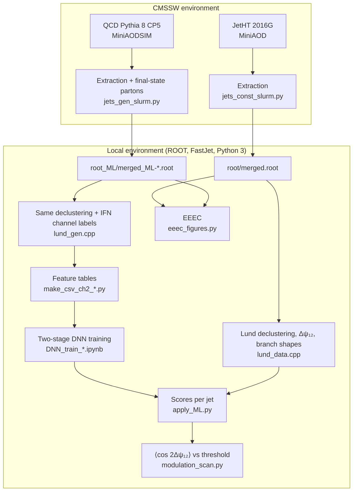

# Exploring Jet Substructure in Public LHC Data

Analysis code and LaTeX source of the master's thesis *Exploring Jet Substructure in Public LHC Data*, a study of collinear spin correlations inside jets with CMS Open Data.

| | |
|---|---|
| **Author** | Alexandre Maria Neves de Barbosa Mendonça |
| **Degree** | MSc in Engineering Physics (Mestrado em Engenharia Física Tecnológica), Instituto Superior Técnico |
| **Supervisors** | Prof. José Guilherme Teixeira de Almeida Milhano, Prof. Nuno Filipe da Silva Fernandes de Castro |
| **Host** | LIP, Phenomenology Group |
| **Date** | October 2026 |
| **Thesis** | [`Thesis/main.pdf`](Thesis/main.pdf) |

---

## Overview

The linear polarisation of intermediate gluons in the parton shower correlates the planes of successive splittings inside a jet. The result is a cos 2Δψ modulation of the azimuthal angle between those planes, whose sign depends on the splitting channel. The g → qq̄ and g → gg channels contribute with opposite signs, so an inclusive measurement dilutes the effect.

This repository implements a complete and reproducible analysis of this effect using only public inputs. It uses proton–proton collisions at √s = 13 TeV recorded by CMS in 2016 and the corresponding Pythia 8 simulation, both released on the [CERN Open Data Portal](https://opendata.cern.ch). Two observables are measured in jets with pT > 700 GeV.

- **Δψ₁₂** is the angle between the planes of the two hardest splittings of the Lund declustering, the primary splitting and the hardest splitting of its softer branch.
- **EEEC** is the azimuthal modulation of the three-point energy correlator, built directly from triplets of jet constituents without any declustering.

To enrich the sample in g → qq̄ splittings, a two-stage neural-network selection is trained on simulation, where the channel of each splitting is labelled with the interleaved flavour neutralisation (IFN) algorithm. The strategy follows the CMS measurement of gluon-polarisation correlations ([arXiv:2603.03689](https://arxiv.org/abs/2603.03689)), applied here to the earlier public 2016 dataset.

---

## Main results

| Quantity | Collision data | Simulation |
|---|---|---|
| ⟨cos 2Δψ₁₂⟩, all jets with a valid Δψ₁₂ | −0.078 ± 0.003 | −0.083 |
| ⟨cos 2Δψ₁₂⟩, jets labelled g → qq̄ | — | −0.167 ± 0.002 |
| ⟨cos 2Δψ₁₂⟩, jets labelled q → qg or g → gg | — | −0.081 |
| ⟨cos 2Δψ₁₂⟩, two-stage selection at threshold 0.30 | −0.128 ± 0.014 | −0.122 ± 0.001 |
| ⟨cos 2Δψ₁₂⟩, two-stage selection at threshold 0.50 | −0.229 ± 0.054 | −0.201 ± 0.005 |
| g → qq̄ purity, before selection → threshold 0.60 | — | 0.03 → 0.48–0.62 |
| EEEC ⟨cos 2ψ⟩, all jets | +0.0200 ± 0.0012 | +0.0186 ± 0.0001 |

Uncertainties are statistical. The purity at the highest threshold is quoted as an interval because it depends on whether jets without a channel label are counted as background or excluded. The first stage of the selection reaches an area under the ROC curve of 0.840. The second stage reaches 0.714, with an area under the precision–recall curve of 0.314 against 0.129 for a classifier without discriminating power.

The selection strengthens the modulation in simulation from −0.12 to −0.27 as the threshold rises from 0.30 to 0.60, and the data follow the simulation within their statistical precision up to a threshold of 0.50. The decomposition by channel shows, however, that every class carries a large non-spin component and that the selection shifts the modulation of each class. The selected modulation therefore cannot be read as that of the g → qq̄ channel alone. The energy correlator shows a small positive modulation that is almost insensitive to the channel. These results are consistent with the CMS observation, but establishing the spin correlations requires a prediction without them, processed through the same selection. The full tables are in Chapter 4 and Appendix A of the thesis, and the systematic uncertainties are discussed in Section 3.6.

---

## Datasets and selection

| Role | Dataset | DOI |
|---|---|---|
| Collision data | `/JetHT/Run2016G-UL2016_MiniAODv2-v2/MINIAOD`, runs 278820–280385 | [10.7483/OPENDATA.CMS.1KTG.X0W4](https://doi.org/10.7483/OPENDATA.CMS.1KTG.X0W4) |
| Training of the selection | `QCD_Pt_800to1000_TuneCP5_13TeV_pythia8`, MiniAODSIM | [10.7483/OPENDATA.CMS.R6GX.8H9J](https://doi.org/10.7483/OPENDATA.CMS.R6GX.8H9J) |
| Purity calibration | `QCD_Pt_600to800_TuneCP5_13TeV_pythia8`, MiniAODSIM | [10.7483/OPENDATA.CMS.FBVA.7HTR](https://doi.org/10.7483/OPENDATA.CMS.FBVA.7HTR) |

The files are never downloaded. The extraction scripts read the file indices of each record, stored in [`runs/`](runs), and stream the files from the portal's storage.

| Requirement | Value |
|---|---|
| Trigger (data only) | any `HLT_AK8PFJet*` path |
| Certified runs (data only) | `Cert_271036-284044_13TeV_Legacy2016_Collisions16_JSON.txt` |
| Jet collection | `slimmedJetsAK8`, anti-kT with R = 0.8 |
| Jet pT | > 700 GeV |
| Jet \|η\| | < 1.7 |
| Dijet topology | at least two selected jets with Δφ > 2 rad |
| Constituent pT | > 1 GeV |
| Simulation only | the reconstructed jet has an associated generator-level jet |

| | Data | Simulation 600 < p̂T < 800 GeV | Simulation 800 < p̂T < 1000 GeV |
|---|---:|---:|---:|
| Events | 30 241 | 5 737 037 | 29 652 066 |
| Selected jets | 60 566 | 11 476 817 | 59 389 760 |
| Jets with a valid Δψ₁₂ | 45 755 | 8 495 207 | 43 071 113 |

---

## Analysis pipeline

The pipeline is split in two environments. Reading MiniAOD requires the CMS software (CMSSW), so the extraction of jets and constituents runs there and produces compact ROOT ntuples. Every later step runs in an ordinary local environment with ROOT, FastJet and Python 3.



### 1. Extraction

The FWLite scripts loop over the files listed in the record indices. For collision data each event is checked against the certified-run list and the trigger, and the jets of `slimmedJetsAK8` passing the kinematic cuts are stored with their constituents (kinematics and electric charge). The event is kept if it has at least two such jets separated by more than 2 rad in azimuth. The simulation is processed in the same way without the certification and trigger requirements, keeping only jets with a generator-level match. It also stores the final-state partons of the event, the last quarks and gluons of the shower before hadronisation, with their PDG identity.

The jobs run as a SLURM array on the LIP cluster with CMSSW_10_6_30 from `/cvmfs`, one output file per input file, and [`python/merge.py`](python/merge.py) joins them with `hadd`.

| Script | Purpose |
|---|---|
| `python/jets_const_slurm.py`, `tasks/run_jets_const.sh` | collision data, SLURM array |
| `python/jets_gen_slurm.py`, `tasks/run_jets_gen.sh` | simulation, SLURM array |
| `python/jets_const_mpi.py`, `python/jets_gen_mpi.py` | the same with MPI, for a single machine or the CMS Open Data container |
| `python/merge.py` | merges `out/out_*.root` into `out/merged.root` |

### 2. Declustering and Lund observables

[`main/lund_data.cpp`](main/lund_data.cpp) reads the ntuple and adds new branches to the same tree. The constituents of each jet are reclustered with Cambridge/Aachen and R = 2, so that the whole AK8 jet ends in a single object. The history is declustered with the `LundGenerator` of FastJet contrib, keeping primary declusterings that pass the Soft Drop condition with z_cut = 0.1 and β = 0 (that is, z > 0.1). The declustering with the largest kT is the primary splitting, with branches p₁ and p₂. The softer branch p₂ is declustered in the same way and the hardest secondary declustering gives the second splitting, with branches p₃ and p₄. Δψ₁₂ is the angle between the planes (p₁, p₂) and (p₃, p₄), oriented as in the CMS measurement and defined in [0, π]. Jets in which no declustering passes the condition are flagged and receive no Δψ₁₂.

For each branch p₁ to p₄ the code also stores the number of constituents, the number of charged constituents, the pT-weighted width σ and the pT-weighted mean constituent momentum ⟨pT⟩. These shapes are the inputs of the flavour selection.

### 3. Generator-level channel labelling

[`main/lund_gen.cpp`](main/lund_gen.cpp) applies exactly the same procedure to simulated jets and adds a channel label to both splittings. The final-state partons are clustered with anti-kT and R = 0.8, and each parton jet is reclustered with Cambridge/Aachen (R = 2) combined with the IFN plugin (α = 2), so that every branch carries an infrared- and collinear-safe flavour. Reconstructed and generator-level jets are matched one to one within ΔR < 0.4. The generator-level history is declustered with the same z > 0.1 and maximum-kT rules, and a reconstructed splitting takes the generator-level channel when both branches match within half of its opening angle.

| Label (`lund_primary_idx_sd`, `lund_secondary_idx_sd`) | Meaning |
|---|---|
| −2 | data only, valid splitting without truth information |
| −1 | no label (declustering failure, or no generator-level jet in simulation) |
| 0 | unmatched |
| 1 | g → qq̄ (quark and antiquark of the same flavour) |
| 2 | q → qg (one quark-like and one flavourless branch) |
| 3 | g → gg (two flavourless branches) |
| 4 | rest (any other flavour combination) |

[`main/tau.cpp`](main/tau.cpp) also runs at this stage and stores formation-time quantities (`tau_time`, `tau_deltaR`), which are not used in the thesis results.

### 4. Flavour selection

The second splitting is classified in two steps. The first network separates matched splittings (g → qq̄, q → qg, g → gg) from unmatched ones, and only jets with a matched score above 0.8 are kept. The second network, trained on matched splittings only, separates g → qq̄ from q → qg and g → gg together. The measurement is then made as a function of a threshold on this g → qq̄ score, between 0.30 and 0.60, with the purity taken from the independent 600–800 GeV sample.

Both networks are Keras feedforward networks with hidden layers of 256, 128 and 64 ReLU units, L2 regularisation, batch normalisation and dropout. The first stage uses 12 features and a softmax output with categorical cross-entropy. The second stage uses 37 features (the same 12 plus symmetric combinations of the two branches) and a sigmoid output with binary focal loss. Δψ₁₂ and the jet pT are deliberately left out of the inputs. Training uses an event-grouped split of about two thirds, one sixth and one sixth.

| File | Purpose |
|---|---|
| `python/make_csv_ch2_gen.py`, `python/make_csv_ch2_data.py` | export the features of the second splitting to CSV |
| `python/make_csv_ch1.py` | the same for the first splitting |
| `python/DNN_train_stage1_unmatched_vs_matched.ipynb` | first stage, matched vs unmatched |
| `python/DNN_train_stage2_qqbar_binary.ipynb` | second stage, g → qq̄ vs q → qg and g → gg |
| `python/DNN_train_4class.ipynb` | alternative, single four-class network (as in CMS) |
| `python/DNN_train_stage2_matched_3class.ipynb` | alternative, three-class second stage |
| `python/GMM_unsupervised_matched_clusters_dpsi12.ipynb` | alternative, unsupervised Gaussian mixture on PCA features |
| `python/models_ML.ipynb` | threshold scan and purity on the calibration sample |
| `python/models.ipynb` | threshold scan on collision data |
| `python/apply_ML.py` | writes the scores `lund_ML_matched` and `lund_ML_qq` into a ROOT file (−1 for jets without a valid Δψ₁₂) |
| `python/compare_methods.py`, `python/compare_purity_full.py` | comparison of the two-stage selection with the alternatives |

The trained models and their preprocessing are committed in `python/models_*/`, and the diagnostic plots and tables of each notebook in `python/outputs_*/`.

### 5. Three-point energy correlator

[`python/eeec_figures.py`](python/eeec_figures.py) runs over every unordered triplet of constituents with non-zero pT. Distances are measured in the (η, φ) plane, and a triplet is kept when √0.1 < ΔR_L < 1 and 0.01 < ΔR_S < 0.1. The azimuth ψ between the plane of the two closest constituents and the plane of their sum with the third is filled with weight pT,a·pT,b·pT,c / pT,jet³ into 100 bins over (−π, π]. The triplet loop is compiled with Numba and the events are processed in parallel blocks. The script fills the distributions for all jets, for each channel label in simulation and for the jets selected at each threshold, and caches them in `python/eeec_results.npz`. The files `eeec_numba.py` and `eeec_numba_ML.py` are standalone versions of the same computation.

---

## Repository layout

```text
Tese-Mestrado/
├── Thesis/                  LaTeX source of the thesis (IST template istdissertacao.cls)
│   ├── main.tex, main.pdf
│   ├── capitulos/           chapters and appendix
│   ├── figuras/             figures, including the TikZ pipeline diagram pipeline.tex
│   └── referencias.bib
├── main/                    C++ analysis (ROOT + FastJet)
│   ├── lund_data.cpp        declustering, Δψ₁₂ and branch shapes for collision data
│   ├── lund_gen.cpp         the same for simulation, plus IFN channel labelling
│   └── tau.cpp              formation-time branches (not used in the thesis results)
├── python/                  extraction, orchestration, ML, EEEC and figure scripts
│   ├── models_*/            trained networks and preprocessors
│   └── outputs_*/           training diagnostics and threshold scans
├── tasks/                   SLURM job scripts for the LIP cluster
├── runs/                    Open Data file indices and certified-run JSON files
│   ├── pp-txt/              JetHT Run2016G
│   ├── pp-txt_ML/           QCD samples, one folder per p̂T interval
│   └── pbpb-txt*/           heavy-ion data and simulation (exploratory)
├── build/                   prebuilt binaries (macOS arm64), rebuilt by run_*.py
├── pdf/                     reference papers
├── slides/                  presentations
├── old_scripts/, old_imgs/  earlier code and plots from the PIC2 project
└── README.md
```

The ROOT ntuples and CSV tables are not tracked. The scripts expect them in `root/`, `root_ML/` and `csv/` at the repository root.

---

## Requirements

**Extraction.** CMSSW_10_6_30 (`slc7_amd64_gcc700`) with its Python 2 FWLite, either from `/cvmfs` as in [`tasks/`](tasks) or inside the CMS Open Data Docker container recommended for each record on the portal.

**Analysis.**
- ROOT 6 with PyROOT and RDataFrame
- FastJet 3 and FastJet contrib with the `LundPlane` and `IFNPlugin` contribs (linked through `-lfastjetcontribfragile`)
- a C++17 compiler
- MPI with `mpi4py`
- Python 3 with `numpy`, `pandas`, `matplotlib`, `numba`, `scikit-learn`, `joblib` and TensorFlow/Keras (models are stored in the `.keras` format)
- Jupyter, for the training notebooks
- `ffmpeg`, only for the formation-time animations

**Thesis.** A TeX Live distribution with LuaLaTeX and Biber.

---

## Reproducing the analysis

The scripts use fixed relative paths. Scripts that build or modify the ntuples (`run_*.py`, `make_csv_*.py`, `apply_ML.py`) run from the repository root, while the figure scripts, comparison scripts and notebooks run from inside `python/`. The selection cuts and paths are set as variables at the top of each script.

### Step 1. Extract the ntuples

On a machine with `/cvmfs` and SLURM, prepare a work directory for each sample.

```bash
# collision data
WORK=/path/to/work_data
mkdir -p $WORK
cp python/jets_const_slurm.py python/merge.py tasks/run_jets_const.sh $WORK/
cp -r runs/pp-txt $WORK/txt
cp runs/pp-txt/Cert_271036-284044_13TeV_Legacy2016_Collisions16_JSON.txt $WORK/
cd $WORK && sbatch run_jets_const.sh    # writes out/out_<file>.root

# simulation (repeat for 600to800)
WORK=/path/to/work_800to1000
mkdir -p $WORK
cp python/jets_gen_slurm.py python/merge.py tasks/run_jets_gen.sh $WORK/
cp -r runs/pp-txt_ML/800to1000 $WORK/txt_ML
cd $WORK && sbatch run_jets_gen.sh      # writes out_ML/out_<file>.root
```

Adjust `--array` in the job script to the number of workers. When all jobs are done, run `python merge.py` in the work directory (set `out_folder = "out_ML"` for simulation). Copy the merged files into the repository with the names used downstream.

| File | Sample |
|---|---|
| `root/merged.root` | collision data |
| `root_ML/merged_ML-800to1000.root` | training sample |
| `root_ML/merged_ML-600to800.root` | calibration sample |

Without a cluster, `jets_const_mpi.py` and `jets_gen_mpi.py` can be run with `mpiexec` inside the CMSSW environment. Check `min_pt`, `max_pt` and `const_min_pt` at the top of these scripts before running them, since the MPI data script is currently set up for a 100–500 GeV jet study.

### Step 2. Declustering and labelling

```bash
mpiexec -n 4 python3 python/run_data.py   # every .root file in root/
mpiexec -n 4 python3 python/run_gen.py    # every .root file in root_ML/
```

Each script compiles the C++ programs into `build/`, removes previous `lund_*` and `tau_*` branches with `clear_root_*.py`, and then runs `tau` and `lund_data` or `lund_gen` on every file. The new branches are written into the same files.

### Step 3. Feature tables

```bash
mkdir -p csv
python3 python/make_csv_ch2_gen.py    # root_ML/*.root -> csv/merged_ML_ch2.csv
python3 python/make_csv_ch2_data.py   # root/*.root    -> csv/merged_ch2.csv
```

The export scripts read every file in their folder and always write the same file name. Run them with one sample at a time and rename the output to the name each notebook reads, `merged_ML_ch2.csv` for the 800–1000 GeV training sample, `merged_ML_ch2-600to800.csv` for the calibration sample and `merged_ch2-pp.csv` for collision data.

### Step 4. Train the selection

From `python/`, run `DNN_train_stage1_unmatched_vs_matched.ipynb` and `DNN_train_stage2_qqbar_binary.ipynb` (and the alternative notebooks if needed). The trained models are already in `python/models_*/`, so this step can be skipped to reproduce the thesis scores.

### Step 5. Apply the selection

Set `ROOT_FILE` at the top of [`python/apply_ML.py`](python/apply_ML.py) and run it from the repository root once for `root/merged.root` and once for `root_ML/merged_ML-600to800.root`.

```bash
python3 python/apply_ML.py
```

### Step 6. Results and figures

```bash
cd python
python3 jetpt_compare.py
python3 modulation_scan.py
python3 eeec_figures.py
# ...
```

| Thesis figure | Script | Output |
|---|---|---|
| 3.2 | `Thesis/figuras/pipeline.tex` | TikZ diagram |
| 4.1 | `jetpt_compare.py` | `jetpt_jets.png` |
| 4.2 | `nconst_compare.py` | `nconst_jets.png` |
| 4.3 | `lund_planes.py` | `lund_{primary,secondary}_{data,sim}.png` |
| 4.4 | `dpsi_inclusive.py` | `dpsi_inclusive.png` |
| 4.5 | `dpsi_labels.py` | `dpsi_labels.png` |
| 4.6, 4.7 | `zplane.py` | `zplane_channels.png`, `zplane_ratios.png` |
| 4.9 | `score_stage2.py` | `score_stage2.png` |
| 4.12 | `compare_purity_full.py` | `purity_full_methods.png` |
| 4.13, 4.15 | `modulation_scan.py` | `modulation_components.png`, `modulation_threshold.png` |
| 4.14 | `z_kinematics.py` | `z_kinematics.png` |
| 4.16, 4.17 | `eeec_figures.py` | `eeec_inclusive.png`, `eeec_labels.png`, `eeec_threshold.png` |

The remaining classifier figures (4.8, 4.10 and 4.11) come from the training and calibration notebooks, which write to `python/outputs_*/`. `print_channel_n.py` prints the composition of a sample by channel label.

### Step 7. Build the thesis

```bash
cd Thesis
latexmk -lualatex main.tex
```

The committed PDF was built with LuaLaTeX and Biber.

---

## Exploratory and legacy material

**Heavy-ion extension.** The same chain was started for PbPb collisions at 2.76 TeV, using HIRun2011 HIHighPt data (CMSSW_4_4_7) and PYQUEN dijet simulation embedded in HYDJET (CMSSW_5_3_20). The relevant files are `python/reco_*`, `tasks/run_pb_*.sh`, `runs/pbpb-txt*/`, the `*_pbpb` notebooks and `python/models_ML-pb.ipynb`. This work is not part of the thesis results, and its prospects are discussed in Section 5.2.

**Formation-time animations.** `iterative_lund.py`, `iterative_z.py`, `iterative_psi_z.py` and `make_video.py` produce frame sequences and videos ordered by the `tau_time` branch. They come from the earlier PIC2 project, together with `old_scripts/` and `old_imgs/`.

**References.** `pdf/` holds the main papers used in the thesis, among them the CMS analysis summary SMP-25-006, the Lund jet plane, spin correlations in parton showers and the three-point energy correlator.

---

## Key references

- CMS Collaboration, *Measurement of angular correlations inside jets induced by gluon polarization in proton-proton collisions at √s = 13.6 TeV*, [arXiv:2603.03689](https://arxiv.org/abs/2603.03689)
- F. A. Dreyer, G. P. Salam, G. Soyez, *The Lund Jet Plane*, [JHEP 12 (2018) 064](https://doi.org/10.1007/JHEP12(2018)064)
- A. Karlberg, G. P. Salam, L. Scyboz, R. Verheyen, *Spin correlations in final-state parton showers and jet observables*, [Eur. Phys. J. C 81 (2021)](https://doi.org/10.1140/epjc/s10052-021-09378-0)
- H. Chen, I. Moult, H. X. Zhu, *Quantum Interference in Jet Substructure from Spinning Gluons*, [Phys. Rev. Lett. 126 (2021) 112003](https://doi.org/10.1103/PhysRevLett.126.112003)
- F. Caola et al., *Flavoured jets with exact anti-kt kinematics and tests of infrared and collinear safety*, [arXiv:2306.07314](https://arxiv.org/abs/2306.07314)

---

## Citation

```bibtex
@mastersthesis{Mendonca:2026thesis,
  author = {Mendonça, Alexandre Maria Neves de Barbosa},
  title  = {Exploring Jet Substructure in Public LHC Data},
  school = {Instituto Superior Técnico, Universidade de Lisboa},
  year   = {2026},
  month  = oct,
  url    = {https://github.com/ISTAlexandre/Tese-Mestrado}
}
```

## Acknowledgements

This work used computing resources provided by LIP and INCD, and the collision data and simulation released by the CMS Collaboration through the CERN Open Data Portal.
